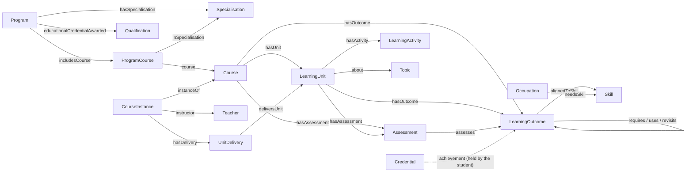

# The Educational Thread ontology

This document explains the vocabulary in [`ontology/edthread.ttl`](../ontology/edthread.ttl): what each concept means, how the concepts relate, and how they correspond to existing standards. It is written for people who want to understand or extend the model; no prior knowledge of RDF is assumed beyond the idea that data is a set of *things* connected by named *relations*.

## In short

Education is described at three levels:

1. **Structure:** a *program* places *courses* in study years and periods, possibly per *specialisation*, and leads to a *qualification*.
2. **Content:** a course states *learning outcomes*, the things a student can do after it, and *assessments* that check them. A teacher may break a course into *learning units*, each with its own topic, outcomes, teaching activities and assessments.
3. **The thread:** learning outcomes are linked to each other across courses, programs and universities (*this outcome requires that one*), and to the skills that occupations need.

Two things are kept out of the shared description on purpose. Teachers appear only in their public role on a *course instance*, and students appear nowhere: a student's achievements are credentials the student holds and shows with consent.

The ontology is deliberately thin. It defines 16 classes and the relations between them, and maps each one to an established standard instead of competing with it.

## Design principles

- **Reuse before invention.** Where schema.org already has the concept, our class is a subclass of it (`et:Course` is a `schema:Course`). Where the European Learning Model (ELM) or ESCO has it, we point to it with `skos:closeMatch`. New terms exist only where no standard covers the need, mainly the dependency relations between outcomes.
- **Outcomes carry the thread.** Courses and units differ between teachers and universities. Learning outcomes can be compared, linked and recognised across them, so the links run between outcomes.
- **The syllabus level and the teaching level are both valid.** Real syllabi state outcomes for the whole course and say nothing about units; a teacher's plan adds units. The model accepts both, and every query follows both paths.
- **Public curriculum, private learners.** Everything in the shared graph is public. Personal data points *into* it (a credential names a public outcome), never the other way round.
- **Rules are separate from meaning.** The ontology says what terms mean; the SHACL shapes in [`shapes/`](../shapes/) say what valid data must contain. GraphDB enforces the shapes on every write.

## The learning unit

A **learning unit** (`et:LearningUnit`) is a block of a course about one topic, with its learning outcomes, teaching activities and assessment. The Europass Learning Model describes such a block as a nested *learning achievement specification*. Readers coming from the ACM/IEEE computing curricula will know a similar term, *knowledge unit*, which there covers content only, without activities or assessment; this model uses *learning unit* throughout.

A learning unit groups the three elements of John Biggs' **constructive alignment**: what students should be able to do (outcomes), what they do to get there (activities), and how that is checked (assessment). In the model a unit has:

| Relation | Points to | Meaning |
|---|---|---|
| `et:about` | a topic (SKOS concept, e.g. from MSC2020) | the one topic the unit is about |
| `et:hasOutcome` | `et:LearningOutcome` | what students can do after the unit |
| `et:hasActivity` | `et:LearningActivity` | lectures, exercise sessions, labs, project work |
| `et:hasAssessment` | `et:Assessment` | the exam, lab report or project that checks the outcomes |
| `et:workloadHours` | number | nominal student workload (1 ECTS credit is 25–30 hours) |
| `et:sequenceIndex` | number | position in the syllabus |

A unit belongs to exactly one course (`et:hasUnit`), so a unit is a building block of a course and, through the course, of a program.

**Units are optional.** None of the 103 LTU syllabi in the data split their course into units; they state outcomes for the whole course. Units come from a teacher's plan, as in the fictitious example course *M0010 Ordinary Differential Equations*, which has five.

**Building block or link?** Both, in two structures at once:

- In the **containment tree** a unit (and the outcomes in it) is a building block: program → placement → course → unit → outcome. This answers *what does this degree consist of?*
- In the **thread** the outcomes inside the unit are links: outcomes in later courses require them. This answers *what does this lead to, and what does it need?*

The tree is built from units; the thread is built from outcomes. That is why the thread survives when two teachers divide the same course into different units.

## The concepts and how they relate



The dotted arrow is the only connection between a student and the graph, and it lives in the student's wallet, not in the graph.

### Program, specialisation and placement

- **`et:Program`** is a degree program as described by its study plan (*utbildningsplan*), for example *Civilingenjör datateknik* (TCDAA). It leads to an **`et:Qualification`**, the degree, with its level in the European Qualifications Framework (`et:eqfLevel`, 7 for a Swedish *civilingenjörsexamen*).
- **`et:Specialisation`** is a track within a program (*inriktning*), such as *Industrial Computer Systems*. A program can have several.
- **`et:ProgramCourse`** is a *placement*: one course placed in one program at a study year and period (`et:studyYear`, `et:studyPeriod`), as mandatory or elective (`et:status`), in the program's common core or in one specialisation (`et:inSpecialisation`). The placement exists because the same course can sit in different years in different programs: *Single Variable Calculus 1* is in year 1, period 1 of TCTEA but period 3 of TCDAA. A program and a specialisation together make a **pathway**: the common core plus that specialisation's courses.

### Course

**`et:Course`** is a course as specified by its syllabus (*kursplan*), stable across offerings. It has a code, a name in English and Swedish, credits, a cycle (first or second), a main subject (*ämne*), and the courses named in its entry requirements (`et:entryRequirementNames`, alongside the full text in `schema:coursePrerequisites`). Its outcomes hang either directly on the course (`et:hasOutcome`, as syllabi state them) or on its units. A course shared by two programs is one course, placed twice.

### Learning outcome

**`et:LearningOutcome`** is one statement of what a student can do after a course or unit, for example *"solve simple differential equations such as first-order separable and linear equations"*. Outcomes may carry the category of the Swedish Higher Education Ordinance (`et:outcomeCategory`: knowledge and understanding, skills and abilities, or judgement and approach) and a level in the revised Bloom taxonomy (`et:bloomLevel`, from remember to create). Outcomes are the nodes of the thread.

### Teaching activity and assessment

- **`et:LearningActivity`** is what students do to reach the outcomes: a lecture series, an exercise session, a lab or project work (`et:activityType`). Activities belong to units; the syllabus text describing teaching in general is not modelled.
- **`et:Assessment`** is how outcomes are checked: an exam, lab work, an assignment, a project or an oral examination (`et:assessmentType`). For LTU courses each assessment is an examination module (*provkod*) with its own credits and grade scale. `et:assesses` says which outcomes it checks. Constructive alignment is visible in the data: an outcome that no assessment checks is flagged by the advisory shapes and by the teacher's check.

### Course instance and teacher

- **`et:CourseInstance`** is one offering of a course (*kurstillfälle*): a term (`et:academicTerm`), a start date, a place, and a teacher (`schema:instructor`, a `schema:Person`). Its **`et:UnitDelivery`** items record which unit is taught in which week, so the actual order can be compared with the dependencies between units.
- **Teachers** are not a class of their own: they appear as the instructor of an instance, in their public role. The model stores no more about them than a course catalogue would publish.

Course instances change every term while syllabi change about once a year, so instances are best kept in a named graph per term (see [the README](../README.md#graphdb-setup)).

### Students

Students are not part of the ontology's shared data, by design.

- What a student has achieved is a **credential** issued by the university and held in the student's own wallet: a W3C Verifiable Credential in the Open Badges 3.0 format, whose achievement is the IRI of a public `et:LearningOutcome`. The ontology names this concept `et:Achievement` (`et:learner`, `et:demonstrates`, `et:issuedBy`, `et:awardedOn`) so that it maps to ELM's learning achievement, but no achievements are stored in the graph.
- The holder is a pseudonymous identifier (a DID). The credential carries no name, e-mail or ID number.
- The student decides who may read the credentials, for what purpose and until when. This consent is an ODRL policy in the presentation's `termsOfUse`. The reader is an office of the university that serves a function (`et:servesFunction`: study advising or admissions).
- When an advisor or admissions officer asks a question, the server checks the consent and passes only the outcome IRIs into the query. Grades and enrolment stay in the university's records system (Ladok at LTU).

### Topics, subjects, skills and occupations

These are shared reference lists (SKOS concept schemes) in [`data/public/vocab/`](../data/public/vocab/):

- **Topics** (`et:about` on units) are organised by area, with MSC2020 codes where they exist.
- **Main subjects** (`et:subject` on courses) follow the Swedish *ämne* used in syllabi, with English names.
- **Skills** and **occupations** stand in for ESCO. Outcomes point to skills (`et:alignedToSkill`), and occupations to the skills they need (`et:needsSkill`). The IRIs are placeholders for real ESCO concepts.

## The thread

Three relations connect a later outcome to an earlier one. All three are sub-properties of **`et:buildsOn`**, so a query for any dependency uses `et:buildsOn` and GraphDB's RDFS-Plus reasoning fills it in.

| Relation | Meaning | Used for |
|---|---|---|
| `et:requires` | hard prerequisite: the later outcome cannot be reached without the earlier one | advising, admissions, sequencing checks |
| `et:uses` | applies the earlier outcome without strictly requiring mastery | showing students where their effort pays off |
| `et:revisits` | returns to the earlier outcome and deepens it | spiral curricula, review |

`et:requires` is the inverse of `isPrerequisiteOf` in 1EdTech's CASE standard for competency frameworks.

**Equivalence** between outcomes of different courses or universities uses the standard SKOS mapping relations: `skos:exactMatch` (interchangeable) and `skos:closeMatch` (accepted in place of each other). The recognition of Other University's outcomes by Example Tech, and the proposed equivalence between LTU's *Signal analysis* and *Signals and systems*, which state the same five outcomes word for word, are both expressed this way.

Links and equivalences that are interpretations, not facts from a syllabus, live in their own named graph ([`proposed-threads.ttl`](../data/public/ltu/proposed-threads.ttl)) with provenance (PROV-O), so every answer that depends on them can be traced to the draft.

## How the ontology relates to standards

| Educational Thread | schema.org | Europass Learning Model (ELM v3) | Other standards |
|---|---|---|---|
| `et:Program` | subclass of `EducationalOccupationalProgram` | learning opportunity | Swedish *utbildningsplan* |
| `et:Specialisation` | | | Swedish *inriktning* |
| `et:ProgramCourse` | | | reading order (*läsordning*) of a study plan |
| `et:Qualification` | subclass of `EducationalOccupationalCredential` | `Qualification` (closeMatch) | EQF level |
| `et:Course` | subclass of `Course` | `LearningAchievementSpecification` (closeMatch) | Swedish *kursplan*; ECTS credits; Bologna cycle |
| `et:LearningUnit` | | `LearningAchievementSpecification` (closeMatch) | |
| `et:LearningOutcome` | target of `teaches` / `assesses` | `LearningOutcome` (closeMatch) | Higher Education Ordinance categories; revised Bloom taxonomy |
| `et:LearningActivity` | | `LearningActivitySpecification` (closeMatch) | |
| `et:Assessment` | target of `assesses` | `LearningAssessmentSpecification` (closeMatch) | LTU *provkod* |
| `et:CourseInstance` | subclass of `CourseInstance` | | Swedish *kurstillfälle* |
| teacher | `Person` as `instructor` | | |
| `et:Achievement` | | `LearningAchievement` (closeMatch) | W3C Verifiable Credentials 2.0, Open Badges 3.0, DID |
| consent | | | ODRL (in the credential's `termsOfUse`) |
| `et:Occupation`, skills | subclass of `Occupation` | | ESCO occupation and skill (closeMatch) |
| topics, subjects | `about` | | SKOS, MSC2020 |
| `et:requires` | | | inverse of CASE `isPrerequisiteOf` |
| equivalence | | | SKOS `exactMatch` / `closeMatch` |
| provenance | `url` to the official syllabus | | PROV-O `wasDerivedFrom`, `wasAttributedTo` |
| validation | | | SHACL |

**Why the two kinds of mapping?** `rdfs:subClassOf` is a commitment: every `et:Course` *is* a `schema:Course`, and search engines and tools that know schema.org can read our data. `skos:closeMatch` is a pointer: ELM's classes are close to ours but structured differently (ELM nests specifications inside each other), so we say they correspond without claiming they are the same. These mappings should be checked against the current ELM release before they are made stronger.

## What the ontology does not (yet) cover

- **Students as data.** Intentional; see above. Course statistics should be published only as anonymised aggregates in a graph of their own.
- **Teachers as more than a name.** No roles, departments or teaching load.
- **Activities at course level.** A syllabus describes teaching in prose; only units carry activities.
- **Which module assesses which outcome.** Most LTU syllabi do not say, so those outcomes have no linked assessment.
- **Bloom levels for real outcomes.** Not stated in syllabi; they could be proposed, like the links, for teachers to confirm.
- **Versions over time.** A syllabus revision replaces the course data; earlier versions are not kept as separate resources.

## A small example

From the LTU data, in Turtle: a course, one of its outcomes, its exam module, and a proposed link from another course's outcome.

```turtle
c:R0004E a et:Course ;
    schema:courseCode "R0004E" ;
    schema:name "Modelling and Control"@en, "Modellering och reglering"@sv ;
    et:credits 7.5 ;
    et:subject subj:automatic-control ;
    et:entryRequirementNames c:F0004T, c:M0018M, c:S0004E ;
    et:hasOutcome lo:R0004E-4 ;
    et:hasAssessment mod:R0004E-0005 .

lo:R0004E-4 a et:LearningOutcome ;
    rdfs:label "be able to analyze the static, dynamic and frequency characteristics of dynamic systems using mathematical methods."@en .

mod:R0004E-0005 a et:Assessment ;
    rdfs:label "Written exam"@en ;
    et:assessmentType et:writtenExam ;
    et:credits 4.5 .

# proposed-threads.ttl: R0004E's entry requirements ask for the Laplace transform from M0018M
lo:R0004E-4 et:requires lo:M0018M-4 .
```

And from the fictitious example, a learning unit with all three parts of constructive alignment:

```turtle
u:M0010-U4 a et:LearningUnit ;
    rdfs:label "Laplace transform"@en ;
    et:about tp:laplace-transform ;          # MSC2020 44A10
    et:workloadHours 40 ;
    et:hasOutcome lo:M0010-LO5 ;             # solve initial-value problems with the Laplace transform
    et:hasActivity [ a et:LearningActivity ; et:activityType et:lecture ] ,
                   [ a et:LearningActivity ; et:activityType et:lab ] ;
    et:hasAssessment asm:M0010-exam, asm:M0010-lab .
```
